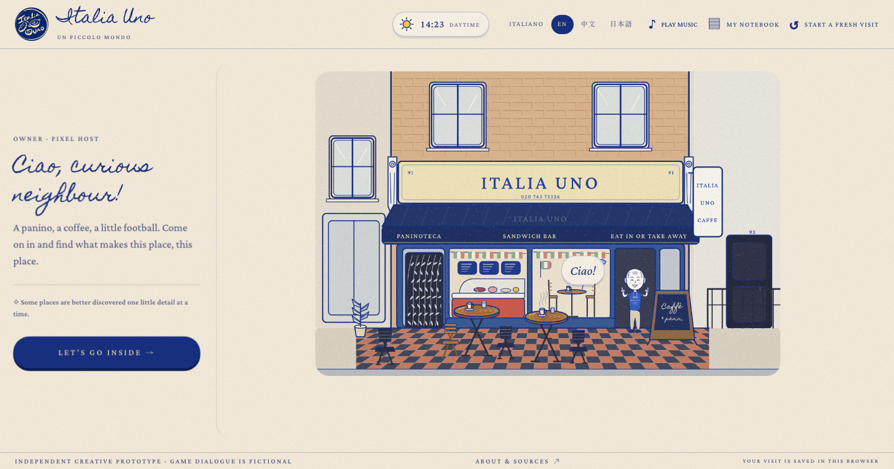

# Italia Uno · A Little Local Adventure

A handcrafted café exploration and restaurant-management game, released for anyone to run, study and remix. Indigo ink, warm paper, an animated fictional host and an original scene-aware Web Audio score.

**Co-creator: [Zhiang Wang](https://github.com/z48gdcngbf-jpg)** — human creative direction, reference selection, interaction and art-direction feedback, and submission decisions. Project home: [z48gdcngbf-jpg/italia_uno](https://github.com/z48gdcngbf-jpg/italia_uno).

[Play the live game](https://z48gdcngbf-jpg.github.io/italia_uno/) · [中文说明](#中文快速开始) · [MIT license](LICENSE) · [Production workflow](docs/WORKFLOW.md) · [Brand and art-direction prompt](docs/ART_DIRECTION_PROMPT.md)

**Gemini collaboration package:** [real shared sessions and agent log](docs/GEMINI_AGENT_LOG.md) · [reusable workflow and prompt pack](workflows/gemini-creative-track/README.md) · [one-page brand-book plan](docs/GEMINI_BRAND_BOOK_PAGE.md) · [demo media index](docs/DEMO_MEDIA.md). The linked sessions document retrospective drafting and review; implementation history remains separately credited.

## Make a different game with this workflow

**[Start at the workflow hub](workflows/README.md)** · **[Custom Game Builder](workflows/custom-game-builder/README.md)**

Want an AI assistant to make a game from someone else's brief? The portable builder covers requirements, mechanics, art direction, implementation, checks and source delivery. Use its master prompt/skill and a fresh project workspace; the café game is only a case study. Email and social modules are optional. The helper prepares a handoff folder—it does not call an AI or generate game code on its own.



## Run it

Use **Node.js 22.13 or newer** and npm. No account, API key, database, paid service or Sites plugin is required.

```sh
git clone https://github.com/z48gdcngbf-jpg/italia_uno.git
cd italia_uno
npm ci
npm run dev
```

Open the local URL printed in the terminal. To build and preview the deployable version:

```sh
npm run build
npm run preview
```

The **`dist/` folder is a complete static website**. Upload its contents to a static host. Serve it over HTTP/HTTPS; opening `dist/index.html` with `file://` does not support the JavaScript module loader. Relative asset URLs support deployment at a root or repository subpath.

```sh
npm test          # game-state, customer journey, owner mode, receipts, music, camera, locales
npm run typecheck
```

`"private": true` in package.json prevents accidental npm registry publication; this repository and its MIT source are public.

## Optional project email setup

If a project owner needs a new mailbox before setting up project services, use the [assisted email-creation workflow](workflows/email-setup/README.md) and [reusable prompt](workflows/email-setup/PROMPT.md). It covers official Gmail/Outlook signup, owner-controlled private steps and a mailbox-access check. This is a documented preparation workflow; no email account is created automatically.

## Optional order-receipt email workflow

The [order-email module](workflows/order-email/README.md) documents a future checkout email for both the customer and shop/project, with an [agent prompt](workflows/order-email/PROMPT.md), disabled configuration, HTML template and offline payload preview. It is a reusable workflow, not a live integration: it does not register mailboxes or send messages, and the game currently keeps its existing receipt behaviour.

## Brand promotion workflow

This repository also includes a local-first Instagram publishing workflow in [`workflows/instagram-publishing/`](workflows/instagram-publishing/). It turns reviewed, authorized brand material into a queue with a pause switch, daily limit, duplicate-prevention ledger and a required post-publication readback. It does not log in, generate posts, or automatically publish; a separately authorized browser operator performs the final action once.

Start with the [brand promotion guide](docs/BRAND_PROMOTION_WORKFLOW.md). Private account settings, media, evidence and ledger data remain ignored locally. The workflow is deliberately paused by default.

## Play

- Enter the street-front café and explore five independent room interactions.
- Choose Yes → Order, browse/search **65 menu entries**, add/remove items and press Done.
- Enjoy the five-second virtual meal. The optional wall-map story has linked sources.
- Checkout for an itemised, downloadable keepsake receipt, then say ciao.
- Click **The boss** for a separate three-day management game: stock, prepare, serve, clean, upgrade and review the results.

English is the default. **Italiano / EN / 中文** are available. Music starts after interaction and can be muted. Customer progress, language and notes stay in the browser; no real orders or payments are sent. Phone layouts use expandable action cards, a fixed order confirmation dock and readable normal-flow dialogue. Desktop welcome text sits beside the street rather than over the host.

## Reuse it for another place

Start with [docs/CUSTOMISE.md](docs/CUSTOMISE.md). All drawing code, game rules, translations, receipt generation and original score source are included. There is no image-generation or audio-service dependency at runtime.

| Change | Source |
| --- | --- |
| Integration, welcome copy, links, browser storage keys | `app/game.tsx` |
| Street, room and counter/table drawing | `lib/handdrawn-scenes.mjs`, `lib/drawing-kit.mjs` |
| Fictional host | `lib/chef-art.mjs`, `app/pixel-host.tsx` |
| Customer journey and guarded transitions | `lib/customer-state.mjs` |
| Three-day owner simulation | `lib/service-state.mjs`, `app/service-shift.tsx` |
| Menu and invented game prices | `lib/menu-data.mjs`, `lib/customer-state.mjs` |
| Original music and synthesis | `lib/music-score.mjs`, `lib/cafe-music.mjs` |
| Downloadable receipt | `lib/receipt.mjs`, `app/keepsake-receipt.tsx` |
| Brand, phone and arrival layouts | `app/handdrawn.css`, `app/mobile.css`, `app/welcome.css` |
| Italian dictionaries | `lib/it/` |

This standalone React/Vite edition is based on **published Site version 18**, source snapshot `4a8a3314b9a8c3b2d8ee30f7043b99b8b7ce5904`. It replaces the hosting wrapper; gameplay and artwork are retained. Old pixel drawing modules are included for reuse, but the active renderer is the hand-drawn Canvas edition. No Sites worker, connectors, account configuration or private project history is included.

## License, sources and credits

Original application source, original code-drawn artwork and synthesized score are released under **MIT**. Keep the copyright and license notice when redistributing. Bundled fonts have their own **SIL Open Font License 1.1** notices; see [THIRD_PARTY_NOTICES.md](THIRD_PARTY_NOTICES.md).

The logo is team-supplied proposed identity artwork. This is an **independent creative prototype**, not the restaurant's official website or an approved endorsement. A software license does not grant trademark rights in a real business name. Reference photographs and commercial-game assets are not redistributed. Menu names come from historical photo references; displayed game prices are invented and are not current restaurant prices. [Sources and limits](docs/SOURCES.json) distinguish verified reporting, creative interpretation and game rules.

Human direction and iterative feedback shaped the concept, identity, flow, interaction and mobile refinements. AI assisted implementation, translations and verification. [The workflow](docs/WORKFLOW.md) records this scope without inventing team roles, owner testimony, or Gemini/Canva deliverables.

### Credits

| Who | What they did |
| --- | --- |
| **[Zhiang Wang](https://github.com/z48gdcngbf-jpg)** and **Team Snapper** | Creative direction, references, the art-direction brief, feedback on every round, and all decisions about what ships. |
| **Gemini** (Google) | Lead drafting and critique partner for the Creative Track package: the [agent log](docs/GEMINI_AGENT_LOG.md), the [reusable creative workflow and prompt pack](workflows/gemini-creative-track/README.md), the [one-page brand-book plan](docs/GEMINI_BRAND_BOOK_PAGE.md) and the [development walkthrough](docs/DEMO_MEDIA.md), all through shared conversations linked in those pages. |
| **Codex** (OpenAI) | The original game build: drawing code, game logic, music, translations and checks, as recorded in [WORKFLOW.md](docs/WORKFLOW.md). |
| **Claude** (Anthropic) | Later changes in this repository: the Start over button, the swinging-postcard hide-and-seek with its room stories and family-table ending, merging the bistro redesign with Japanese for the new game, the phone and desktop layout fixes, and the Instagram workflow docs. These commits carry a "Co-Authored-By: Claude" line. |

Each AI's work was reviewed and directed by the people above. The commit history shows exactly who changed what.

## 中文快速开始

这是可以独立运行、修改和复用的完整开源游戏。安装 Node.js 22.13+ 后运行：

```sh
npm ci
npm run dev
```

`npm run build` 生成可部署到静态网站服务的 `dist/` 文件夹；`npm run preview` 可预览构建结果。无需 AI 密钥、Sites 账号、后端或数据库。主程序、美术绘制代码、音乐合成、三语文本、65 项菜单、顾客流程、老板经营模式、小票及测试均包含在仓库中。

代码采用 MIT 许可证，可修改、分发及用于自己的项目，需保留许可证与版权声明；字体继续遵守随附的 OFL。改成自己的店铺时，请同步替换名称、Logo、地图链接、店史资料和本地存储键，参考 [修改指南](docs/CUSTOMISE.md)。
