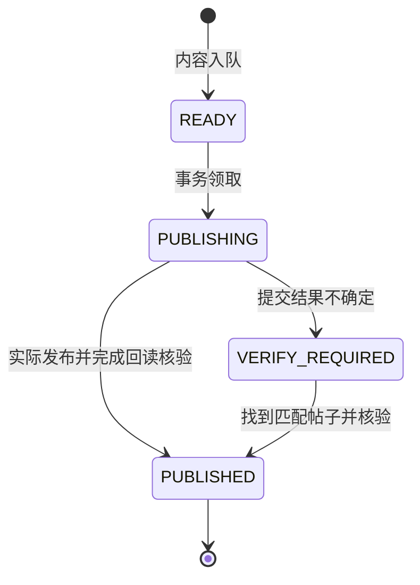

# Instagram Publishing Agent

如需先创建项目邮箱，可选用[协助创建邮箱流程](../email-setup/README.md)。邮箱注册、Instagram 注册和发布授权分别处理；此模块不会自动创建账号或启动发布。

[English](README.md) · [简体中文](README.zh-CN.md)

**以 Loop Engineering 为核心的 Instagram 发布流程。**

项目把每日运营组织成持续的状态反馈循环：

**观察状态 → 决定下一步 → 领取任务 → 执行动作 → 核验结果 → 持久化 → 下一轮。**

每轮都根据本地账本、最新配置与真实页面状态重新判断。发布成功、结果不确定、
素材未就绪和暂停状态会影响下一轮的行动。

## Loop Engineering 在这里具体指什么

这里的重点是把 agent 每轮的输入、动作范围、反馈和恢复规则落实到工程中：

| 环节 | 工程实现 |
| --- | --- |
| 状态 | SQLite 保存任务、内容快照、发布时间槽和回执；跨轮次保留。 |
| 决策 | `tick` 判断是否有到期且可发布的内容；缺素材时等待。 |
| 执行边界 | `claim` 在事务中领取任务；`check` 在最终提交前重查暂停、账号、日期和素材。 |
| 真实反馈 | 发布后重新打开实际帖子，核对作者、图片、文案与永久链接。 |
| 恢复 | 无法确认结果时进入 `VERIFY_REQUIRED`，先核对平台现状。 |
| 可观测性 | 区分“已登记排程”“实际触发”“本地流程执行”和“真实发布”。 |
| 验证 | 自动化测试覆盖本地状态与控制约束；离线演示不访问 Instagram。 |

核心状态转换：



`PUBLISHING` 表示已记录发布意图；页面可能尚未提交。`PUBLISHED` 需要操作者实际核验。
配置中的暂停和素材就绪开关独立于上述任务状态。

本地账本与 Instagram 无法组成一个原子事务，因此本项目不保证端到端的 exactly-once。
跨日期遗留的不确定任务仍需 agent 主动检查；回执中的布尔字段也不能替代真实平台回读。

## 包含的代码

- `agent.py`：持久化队列、任务领取、发布前检查、暂停和回执记录。
- `test_agent.py`：并发、防重复、素材变化、时间边界和证据校验测试。
- `tools/demo.py`：使用临时目录演示一轮执行与不确定结果处理。
- `config.example.json`、`examples/`：默认暂停的配置及内容、证据模板。
- `render-example.cjs`：可选的示例图片生成脚本。
- `docs/`：浏览器执行协议、日常调度提示词和 Loop Engineering 设计说明。

## 快速体验

克隆仓库后，使用 Python 3.9+ 运行：

```sh
python3 -m unittest -v test_agent.py
python3 tools/demo.py
python3 agent.py init your_instagram_handle
python3 agent.py status
```

初始化会创建本地 `config.json`，保持暂停发布、正式素材未就绪。演示只操作临时账本，
不会登录 Instagram，也不会发布帖子。

## 如何接入真实发布

由具备浏览器操作能力、且获得账号授权的 agent 执行
[操作协议](docs/OPERATIONS.md)。外部调度器负责定时唤醒，CLI 负责持久化状态与检查。
当前 Python 程序本身不包含浏览器执行器、AI 内容生成服务或调度器。

本仓库验证的发布范围为单张 PNG/JPEG Feed 图片。官方 Meta API、云端托管、轮播、
Reels、Stories 和专业 Insights 尚未集成。本机方案依赖电脑、应用与登录会话可用。

当前 Loop Engineering 覆盖执行控制、证据和恢复流程；内容效果驱动的自动策略学习
尚未实现。

完整英文说明见 [README](README.md)，循环设计见
[Loop Engineering](docs/LOOP_ENGINEERING.md)，依赖及许可说明见
[第三方声明](THIRD_PARTY_NOTICES.md)。
