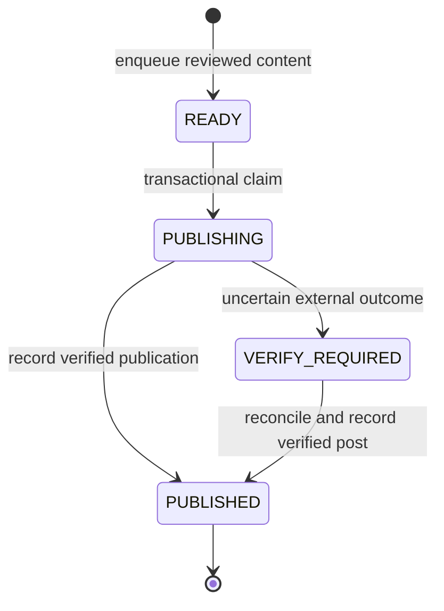

# Loop engineering

This document describes how the repository organizes publication work as a
persistent control-and-feedback loop. It maps the design to the current code,
including the responsibilities that remain with the surrounding agent.

## The unit of work is one bounded iteration

An iteration starts when an external scheduler or operator invokes the agent.
It observes current conditions, chooses an eligible next step, performs a bounded
action when appropriate, verifies the external result, and preserves the outcome.

The next iteration reads those records again. Conversation memory alone is not
the publication ledger. A successful iteration can end in an explicit waiting state
without publishing anything.

### Loop contract

| Stage | Inputs | Output or invariant |
| --- | --- | --- |
| Observe | Current configuration, durable ledger, approved manifests, actual browser UI | Current facts and unresolved work are known to the agent. |
| Decide | Pause/readiness controls, local date, due time, prior outcomes | One eligible job or an explicit wait/reconcile result. |
| Claim | Saved job payload and SQLite transaction | One successful claim for the job; intent persisted as `PUBLISHING`. |
| Act | Claimed payload and a fresh final gate | One authorized external submission. |
| Verify | Platform result, reopened post, account, image, caption, permalink | Verified publication or unresolved outcome. |
| Persist | Evidence or uncertainty | `PUBLISHED` or `VERIFY_REQUIRED`, retained for later runs. |
| Repeat | New trigger, saved state, and changed external conditions | A new decision based on the updated situation. |

## Architecture and responsibility

| Component | Responsibility | Current implementation |
| --- | --- | --- |
| Scheduler | Wake the agent and provide run context. | External; an example prompt is provided. |
| Agent | Review content, inspect actual state, decide, act, and verify. | External browser-capable agent following the protocol. |
| Control and state layer | Persist intent, validate gates, track outcomes. | `agent.py`, SQLite, local configuration, and manifests. |
| Platform | Accept a submission and expose the resulting post. | Instagram, observed by the external agent. |
| Feedback record | Preserve what was verified for the next iteration. | Local evidence files and the ledger's evidence field. |

The repository's executable code implements the control and state layer. The
operating documents specify the surrounding agent loop. Cloning the repository
does not install the browser executor or scheduler.

## Persisted publication state machine

- `READY`: a manifest was queued with its account, caption, asset paths, due time,
  local date, and content fingerprint.
- `PUBLISHING`: publishing intent has been claimed. Share may or may not have
  been submitted; this state alone proves neither submission nor publication.
- `VERIFY_REQUIRED`: the result needs external reconciliation. There is no blind
  reset command that makes another submission eligible.
- `PUBLISHED`: the operator supplied an actual permalink and explicit verification
  attestations after observing the platform result and reopening the post.

Pause and brand-content readiness are configuration controls, not publication
statuses. A failed final check leaves the post's existing state intact.

## Engineering the action boundary

### Durable intent before external effects

`claim` uses a SQLite transaction and writes `PUBLISHING` before an external Share
action. Concurrent attempts to claim the same job cannot both succeed. The ledger
also has unique account/date/slot and content-fingerprint constraints.

The content fingerprint includes the account, caption, and media bytes. A saved
payload preserves the queued intent; changed media prevents the final check from
passing. Private state must persist across runs to retain these protections.

### Recheck immediately before submission

`check` rereads the configuration and validates the job's account, state, current
local date, due time, media fingerprint, pause control, and production readiness.
The browser agent separately verifies that the actual active account and preview
match the saved intent.

The final check and browser click are separate operations. A pause or process crash
between them cannot be handled as an atomic transaction with Instagram. Keep the
gap small and obey any new pause instruction before submitting.

### External feedback closes the publication loop

The browser agent observes the platform result and then reopens the actual post.
It checks the author, complete image, caption, and permalink before recording
success. A file upload, queued job, loading spinner, or scheduler invocation is
insufficient evidence of publication.

`record` validates a canonical permalink, configured account, strict boolean
attestations, and an eligible ledger state. It does not independently fetch the
post or inspect screenshot pixels. The operator remains responsible for truthful
verification.

## Failure and recovery examples

| Situation | Current response | What the next iteration does |
| --- | --- | --- |
| Brand content is pending | `tick` returns a waiting result. | Recheck readiness later; retain state and avoid filler posts. |
| Two workers try the same job | Only one transactional claim succeeds. | The other worker observes an in-flight or terminal state. |
| Media changes after queueing | Claim/final verification fails the fingerprint check. | Resolve the content change before any submission. |
| A pause occurs after claim | A later final check fails. | Wait for an authorized resume; inspect the existing intent. |
| The process stops before Share | The durable record may remain `PUBLISHING`. | Inspect actual posts and browser state; do not assume the action ran. |
| Share is submitted but the result is lost | Mark uncertainty; avoid another Share. | Reconcile the actual platform post before deciding on recovery. |
| The date changes before submission | The expired job fails its final gate. | Review and intentionally reschedule content rather than automatically catching up. |

For an uncertain submission, the operator looks for a matching actual post. If it
exists, verify it and record its permalink from `VERIFY_REQUIRED`. If it cannot be
resolved, retain uncertainty and escalate for a deliberate recovery decision.
The current CLI does not implement a verified-negative reset procedure.

## Guarantees and boundaries

These controls reduce duplicate attempts. **They do not guarantee exactly-once
publication across SQLite and Instagram.** There is no shared transaction or
platform-side idempotency key in the browser prototype.

`tick` examines in-flight and published records for the current local date. It does
not automatically block every new day on older unresolved records. The surrounding
agent must inspect the ledger across dates before new submissions and reconcile
older `PUBLISHING` or `VERIFY_REQUIRED` jobs.

Other boundaries remain explicit:

- The lock coordinates workers using the same SQLite database, not independent
  installations with separate ledgers.
- Deleting or replacing the ledger removes its deduplication history.
- Scheduler delivery and browser availability are external dependencies.
- The built-in workflow handles one single-image Feed post per account per day.
- The CLI's evidence validation is a local contract, not an independent platform audit.

## Observability and evaluation

Keep these outcomes separate in run records:

1. **Schedule registered:** a scheduler accepted a configuration.
2. **Run delivered:** an actual scheduled invocation reached the agent.
3. **Local workflow executed:** the agent inspected state and ran a bounded iteration.
4. **Post verified:** the actual platform result was reopened and checked.

Retain planned time, actual delivery time, decision, job ID, final state, and the
evidence reference in local run records. Log actual delays rather than claiming
exact-time execution. Report meaningful completions, failures, and required actions;
unchanged waiting states can remain quiet.

The current tests exercise the control loop's local contracts:

| Test area | What is checked |
| --- | --- |
| Concurrency and identity | One claim succeeds; due-job selection reuses the same job. |
| Action gates | Pause, expired jobs, due time, content readiness, and media integrity. |
| Recovery | Uncertain submissions cannot be blindly reclaimed and suppress another due submission that day. |
| Evidence | Required readback attestations, strict booleans, and canonical Instagram URLs. |
| Initialization | A new configuration is paused and an existing configuration is not overwritten. |

The offline demo ends with a simulated uncertain result in a disposable ledger.
It makes no platform requests and publishes nothing. Real browser integration
requires separate observation and evidence; passing CI alone does not establish it.

## Execution feedback and content learning

This implementation closes the operational loop around intent, action, evidence,
and recovery. Performance-driven editorial learning—such as changing topics or
formats based on measured reach, saves, or conversion—is an extension point.
There is no implemented automatic strategy learner or model self-modification.
